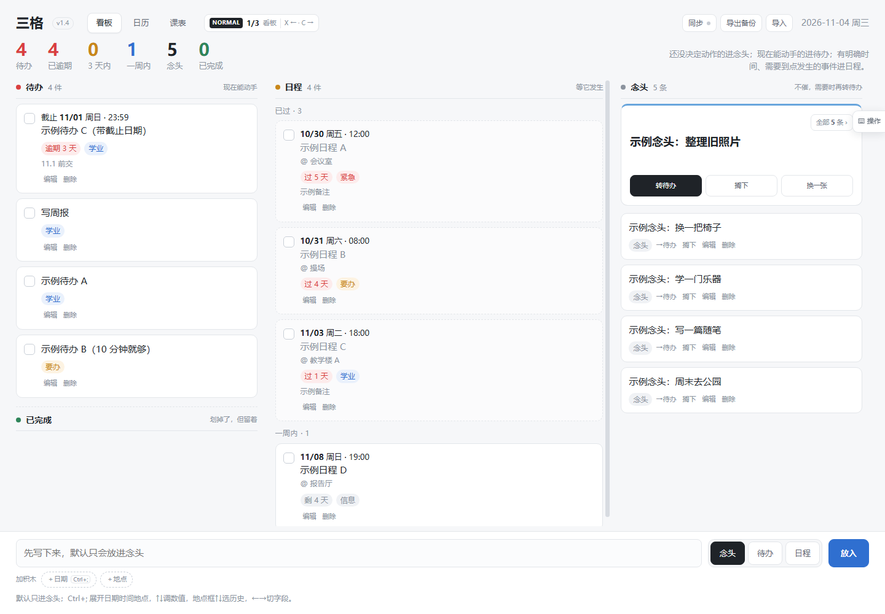
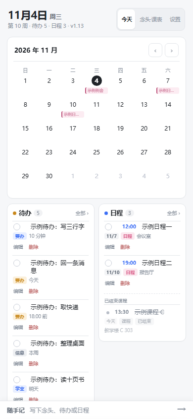
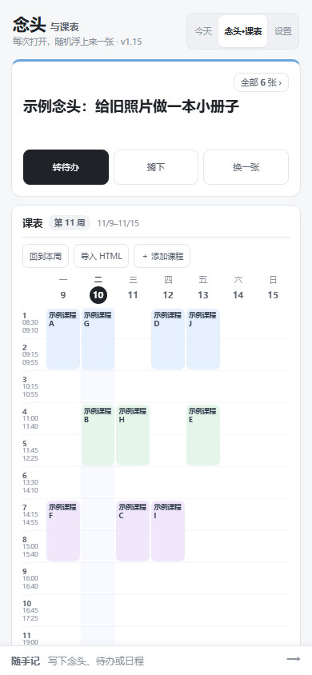

# 三格（暂名）

记录待办、日程和念头，查看日历与课表。支持 Windows 和 Android。

## 下载

| 平台 | 安装包 | 使用方法 |
|---|---|---|
| Windows | [下载 Windows 版 · ZIP](https://github.com/hongsawd/trilist/releases/download/v1.16.1/sange-windows-v1.6.zip) | 完整解压，打开「三格」文件夹，双击 `启动三格.vbs` |
| Android | [下载 Android 版 · APK](https://github.com/hongsawd/trilist/releases/download/v1.16.1/sange-android-v1.15.apk) | 在手机上打开 APK 安装；更新时直接覆盖安装 |

[查看所有版本与附件](https://github.com/hongsawd/trilist/releases)

Windows 包已包含运行环境，解压后即可启动。首次打开是空白清单。

安装包放在发布页的 **Assets（附件）** 中，文件名分别是 `sange-windows-v1.6.zip` 和 `sange-android-v1.15.apk`。开发用源码另列为 `sange-source-v1.16.1.zip`。

## 同步

向作者领取个人令牌，在应用的「同步」中粘贴，点击「立即同步」。自己的手机和电脑填写同一枚令牌即可。

同步可选，不开启也能正常使用。

## 预览

  
  

## 使用

- 待办、日程和念头支持编辑、删除与撤销。
- 日历显示日程和截止日期，课表支持导入 HTML。
- Windows 按 `Ctrl+Alt+Space` 打开或收起侧栏，按 `Ctrl+Alt+Q` 查看近期安排。
- 右上角齿轮可设置提醒：提前 30 分钟、自定义，或不提醒。

## 后续计划

- 独立的笔记页面。
- 调整页面组织，并重新考虑项目名称。

## 开发

[开发与测试说明](docs/DEVELOPMENT.md) · [同步服务部署](sync-worker/README.md) · [更新记录](CHANGELOG.md)
